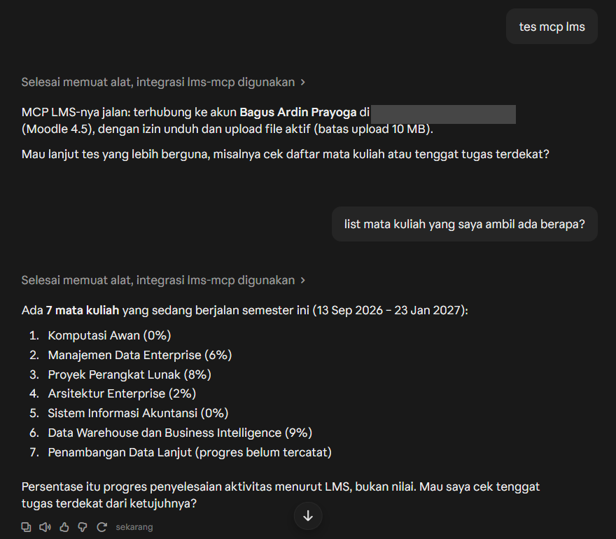
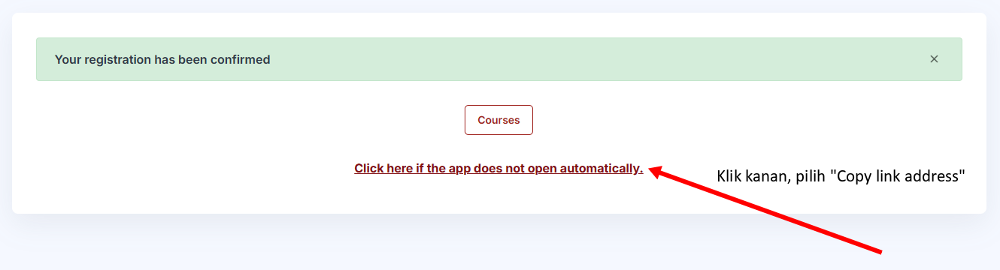
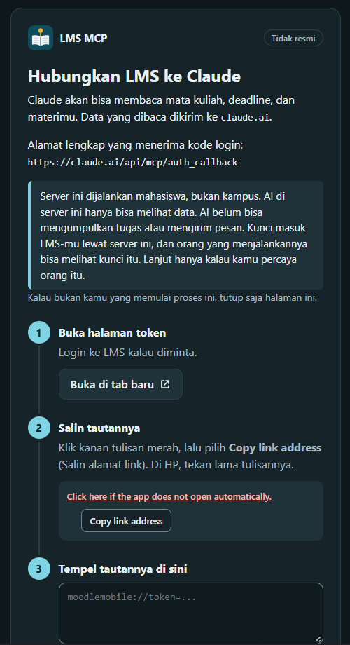

# lms-mcp

Bagus Ardin Prayoga

lms-mcp menghubungkan AI dengan LMS kampus kita. Lewat penghubung ini, kita bisa minta AI melihat mata kuliah, tenggat, dan materi, serta mengambil file, memakai akun kita sendiri.

Kita membuatnya sebagai mahasiswa, terpisah dari kampus dan pengelola LMS. Aturan kuliah tetap tanggung jawab kita.



Contoh di claude.ai. Alamat LMS di jawaban AI sengaja ditutup.

## Pilih cara pakai

| Dipakai di | Cara | Perlu dipasang di internet? |
|---|---|---|
| Claude Code, Codex, Claude Desktop, Cursor, VS Code, Antigravity, atau AI di komputer seperti LM Studio | Di komputer kita | Tidak |
| claude.ai, ChatGPT, dan Grok | Server yang sudah jalan | Tidak, tinggal sambungkan |

Kalau dipakai di komputer, kunci masuk tetap di komputer kita. Kalau lewat situs, kita memakai server yang sudah disiapkan, untuk AI yang dibuka di browser.

## Yang bisa diminta ke AI

Nama di kolom kiri adalah nama yang AI pakai. Kita cukup memintanya dengan bahasa biasa.

| Nama | Kegunaan | Cara |
|---|---|---|
| `get_profile` | Siapa kita, dan apakah akun ini boleh mengunduh atau mengunggah file | Keduanya |
| `list_courses` | Daftar mata kuliah: yang sedang berjalan, yang sudah selesai, dan yang akan datang | Keduanya |
| `get_upcoming_deadlines` | Tenggat beberapa hari ke depan di semua mata kuliah, ditambah tugas yang terlambat dan belum dikumpulkan | Keduanya |
| `get_course_materials` | Isi satu mata kuliah per bagian: kegiatan, file, dan tautan luar | Keduanya |
| `read_file_text` | Membaca tulisan di dalam file, per halaman, supaya AI bisa merangkum atau menjawab pertanyaan | Keduanya |
| `get_file_link` | Membuat tautan supaya file dibuka di browser | Keduanya |
| `list_assignments` | Daftar tugas di satu mata kuliah, lengkap dengan tenggat, status, dan nilai | Keduanya |
| `get_assignment` | Detail satu tugas: perintah dosen, aturan file, yang sudah dikirim, dan komentar dosen | Keduanya |
| `download_file` | Mengunduh file ke komputer kita setelah kita menekan tombol di browser. Paling besar 200 MB | Di komputer |

Setiap jawaban yang ada tanggalnya juga menyertakan jam sekarang, tanggal lengkap dengan nama hari, dan sisa waktunya. AI jadi tidak perlu menebak hari ini. Tebakan seperti itu sering meleset.

Tugas sisa salinan semester lalu dipisahkan. Tenggatnya jauh sebelum mata kuliah dimulai, jadi tidak terlihat seperti tugas yang belum dikumpulkan. Daftar tenggat juga memeriksa tugas dan kuis yang tidak muncul di kalender karena sudah ditandai selesai, serta draf yang sudah diunggah tetapi belum dikirim ke dosen.

Dari awal, AI hanya bisa melihat. Mengumpulkan tugas dimatikan sampai kita menyalakannya sendiri. Tugas gampang terkirim tanpa kita sadari, dan LMS mencatatnya atas nama kita. Mengirim pesan dan menulis di forum belum bisa.

### Mengumpulkan tugas

Fitur ini baru dicoba di LMS tiruan. Mulai dari tugas latihan dulu. Untuk menyalakannya, isi `LMS_ENABLE_WRITE=1` di file pengaturan.

| Cara | Nama | Yang terjadi |
|---|---|---|
| Di komputer | `save_assignment_file`, `submit_assignment` | Halaman terbuka di browser. Kita yang menekan tombol |
| Lewat situs | `create_upload_link` | AI memberi tautan. Kita sendiri yang memilih file dan menekan tombol |

- **AI tidak menekan tombolnya sendiri.** Di komputer, halaman konfirmasi terbuka di browser. Halaman itu menampilkan mata kuliah, bagian, tugas, tenggat, dan file. Tidak ada yang terunggah sebelum kita menekan tombol.
- **Banyak tugas langsung terkumpul begitu file disimpan.** Tugas seperti ini tidak punya tahap simpan dulu. Halaman konfirmasi minta kita mencentang sebelum lanjut.
- **File lama tidak diganti diam-diam.** Kalau tugas sudah berisi file, halaman yang sama minta centang untuk menggantinya.
- **Di komputer, file tugas hanya boleh diambil dari tempat yang aman.** Tempatnya folder Dokumen, Unduhan, dan Desktop. Kita bisa mengubahnya lewat `LMS_UPLOAD_DIRS`. File rahasia seperti `.env`, kunci masuk komputer, dan `credentials.json` ditolak. File yang di dalamnya ada kunci masuk LMS juga ditolak.
- **File yang baru diunduh dari LMS tidak bisa langsung dikumpulkan.** Salin dulu ke folder lain kalau memang itu tugas kita.
- **Lewat situs, tautan unggah berlaku 15 menit dan sekali pakai.** File diteruskan ke LMS. Server tidak menyimpannya.
- **Isi tugas tetap tanggung jawab kita.** Yang diunggah hanya file yang kita pilih.

### Konfirmasi di browser

Mengunduh file, menyimpan file tugas, dan mengirim tugas ke dosen menunggu kita. Di komputer, halaman terbuka di browser dan menunggu paling lama 3 menit. Halaman itu menampilkan mata kuliah, bagian (misalnya Minggu 3), kegiatan, dan berkasnya, sesuai yang tertulis di LMS. Tombolnya hanya bisa kita tekan. Kalau ditolak atau waktunya habis, tidak ada yang diunduh atau dikumpulkan.

Lewat situs, file tidak diunduh ke komputer. Mengumpulkan tugas tetap lewat halaman unggah. Halaman itu juga menampilkan mata kuliah serta bagiannya.

### Batasan membaca file

`read_file_text` bisa membaca PDF, PowerPoint (PPTX), Word (DOCX), teks biasa, Markdown, CSV, dan HTML, sampai 50 MB. File tidak disimpan di server.

- **File di Office 365 tidak bisa dibaca dari sini.** Dosen kadang menaruh materi di Office 365, lalu menautkannya ke LMS. LMS menolak mengirim file seperti itu. File ini ditandai tersimpan di luar LMS. Buka lewat `get_file_link` di browser, lalu unggah sendiri ke AI kalau isinya perlu dibaca.
- **Gambar tidak terbaca.** PDF hasil scan hampir tidak punya tulisan. Gambar dan diagram di slide juga tidak ikut.
- **Beberapa format lama belum bisa,** termasuk Excel, PowerPoint lama (PPT), dan Word lama (DOC).
- **File yang bisa dijalankan tidak diunduh,** termasuk `.exe`, skrip, dan halaman `.html`. Buka lewat `get_file_link` kalau memang perlu.

## Ambil kunci masuk

LMS kita hanya bisa masuk lewat Office 365. Kunci masuknya kita ambil dari halaman yang biasa dipakai aplikasi HP Moodle.

1. Buka halaman kunci masuk LMS, lalu masuk kalau diminta. Di komputer, alamatnya muncul setelah menjalankan `uv run lms-mcp token` (lihat [Pakai di komputer](#pakai-di-komputer)). Lewat situs, halaman masuk server sudah menautkannya.
2. Klik kanan tautan "Click here if the app does not open automatically", lalu pilih "Copy link address".



Tautan itu harus sama persis, huruf demi huruf. Jangan diketik ulang. Jangan disalin dari gambar. Kalau ditolak, tekan `F12` di halaman itu, buka tab Console, lalu tempel perintah ini:

```
copy(document.getElementById('launchapp').href)
```

Kunci masuk ini sama saja dengan membuka akun LMS kita. Jangan dibagikan. Jangan ditempel ke chat AI. Jangan ikut di tangkapan layar.

Kunci ini punya masa berlaku yang diatur pengelola LMS. Biasanya sekitar 12 minggu. Kalau sudah habis, AI membalas bahwa akses ditolak (`accessexception` atau `invalidtoken`). Ulangi langkah di atas.

## Pakai di komputer

Kita butuh [uv](https://docs.astral.sh/uv/) untuk memasang proyek ini.

```bash
git clone https://github.com/bagusardin25/lms-mcp.git
cd lms-mcp
uv sync
```

Salin `.env.example` menjadi `.env`. Alamat halaman kunci masuk muncul dengan perintah di bawah.

Simpan tautannya di luar folder proyek, misalnya di `~/.lms-mcp/token`, lalu isi lokasinya di `LMS_TOKEN_FILE`. Kalau `LMS_TOKEN` juga diisi, yang dipakai adalah `LMS_TOKEN`.

Jangan tempel tautan itu ke chat AI. Jangan bagikan chat yang sempat memuatnya. Kalau chat itu sudah terkirim, reset kunci di halaman Security keys LMS.

```bash
uv run lms-mcp token
```

File `.env` tidak ikut saat proyek ini diunggah ke GitHub. Setelah kunci masuk terisi, cek apakah LMS bisa dibuka:

```bash
uv run lms-mcp check
```

Ganti `/path/ke/lms-mcp` dengan lokasi folder proyek ini di komputer kita.

**Claude Code**

```bash
claude mcp add lms-mcp -- uv run --directory /path/ke/lms-mcp lms-mcp serve
```

**Codex**

```bash
codex mcp add lms-mcp -- uv run --directory /path/ke/lms-mcp lms-mcp serve
```

**Claude Desktop, Cursor, Antigravity, LM Studio, dan aplikasi lain yang memakai format `mcpServers`**

```json
{
  "mcpServers": {
    "lms-mcp": {
      "command": "uv",
      "args": ["run", "--directory", "/path/ke/lms-mcp", "lms-mcp", "serve"]
    }
  }
}
```

VS Code memakai format yang mirip di `mcp.json`. Kuncinya `servers`.

Kalau aplikasinya tidak menemukan `uv`, isi `command` dengan lokasi lengkap program `uv` di komputer kita.

## Pakai lewat situs

Server untuk teman-teman sudah jalan. Tidak perlu memasang apa pun.

Alamat yang ditempel ke AI:

`https://lms-mcp.up.railway.app/mcp`

Bisa disambungkan dari claude.ai, ChatGPT, dan Grok. Saat menyambungkan, muncul halaman di browser. Di halaman itu kita menempel kunci masuk LMS. Halaman yang sama menjelaskan siapa yang menjalankan server ini, dan apa yang AI boleh lakukan.



Sebelum menyambungkan, baca [PRIVASI.md](PRIVASI.md). Isinya data apa saja yang dibaca dari LMS, apa yang disimpan, siapa yang bisa melihat kunci masuk, dan cara memutus akses.

Kondisi server sekarang:

- AI hanya bisa melihat mata kuliah, tenggat, materi, dan tugas beserta nilai dan komentar dosen. Mengumpulkan tugas, mengirim pesan, dan menulis di forum tidak bisa dilakukan dari server ini.
- Tiap orang memakai kunci masuknya sendiri. Server tidak menyimpan daftar akun. Orang lain tidak bisa membuka LMS kita selama mereka tidak memegang kunci masuk kita.
- Server tidur kalau sekitar 5–10 menit tidak ada yang memakai. Permintaan pertama setelah itu kadang gagal. Ulangi saja ke AI.
- Server tidak menyimpan file yang dibaca.
- Orang yang menjalankan server ini bisa melihat kunci masuk saat teman menempelkannya. Server harus memakai kunci itu untuk bertanya ke LMS. Teman yang tidak nyaman sebaiknya memakai cara di komputer.
- Untuk memutus akses, reset kunci di halaman Security keys LMS. Izin yang tersimpan di aplikasi AI ikut berhenti setelah kunci itu di-reset.
- Data yang AI baca juga terkirim ke perusahaan AI yang dipakai, misalnya Claude, ChatGPT, atau Grok.
- Tulisan di LMS bisa berisi kalimat yang mencoba menyuruh AI. Baca dulu sebelum menyetujui.

Cara menyambungkan:

- **claude.ai:** Settings, Connectors, Add custom connector, lalu tempel alamat di atas.
- **ChatGPT:** nyalakan Developer Mode, lalu tambahkan di Apps & Connectors. Tidak semua paket punya menu ini.
- **Grok:** tambahkan sebagai sambungan khusus dengan alamat yang sama.

Setelah itu salin kunci masuk seperti di bagian [Ambil kunci masuk](#ambil-kunci-masuk), lalu tempel di halaman yang muncul.

## Hal yang perlu dijaga

- Isi LMS bisa ditulis siapa saja di kelas, termasuk kalimat yang mencoba menyuruh AI. Baca dulu sebelum menyetujui apa yang AI mau lakukan.
- Data LMS yang dibaca AI ikut terkirim ke perusahaan pembuat AI itu. Kalau AI-nya berjalan di komputer kita, data itu tetap di komputer kita.
- Kunci masuk hanya dikirim ke LMS. Tautan unduhan dari situs lain ditolak.
- Semua yang kita lakukan tercatat di LMS atas nama akun kita.
- Unduh, unggah, kirim tugas, dan pembuatan tautan unggah juga dicatat di `~/.lms-mcp/audit.log`. Lokasinya bisa diganti lewat `LMS_AUDIT_LOG`. Catatan itu memuat waktu, apa yang dilakukan, berhasil atau tidak, dan nama mata kuliah atau tugas. Kunci masuk dan isi file tidak ikut.
- Di komputer, sambungkan ke satu AI saja. AI yang bisa membuka folder proyek bisa membaca file pengaturan. Simpan kunci masuk lewat `LMS_TOKEN_FILE` di luar folder proyek, dan tambahkan `.env` ke `.cursorignore` sendiri.
- Di server yang sudah jalan, orang yang menjalankannya tetap bisa melihat kunci masuk teman. Itu batas dari cara ini, selama server yang bertanya ke LMS.
- Kalau menemukan celah yang bisa membuat kunci masuk orang lain terbaca, jangan tulis di issue publik. Cara melapornya diam-diam ada di [SECURITY.md](SECURITY.md).

## Pengaturan di komputer

| Nama | Artinya |
|---|---|
| `LMS_TOKEN` | Tautan kunci masuk. Kalau diisi, ini yang dipakai |
| `LMS_TOKEN_FILE` | Boleh dikosongkan. Lokasi file kunci masuk di luar folder proyek. Dipakai kalau `LMS_TOKEN` kosong |
| `LMS_DOWNLOAD_DIR` | Boleh dikosongkan. Folder tujuan unduhan. Kalau kosong, yang dipakai `Downloads/lms-mcp` |
| `LMS_AUDIT_LOG` | Boleh dikosongkan. Lokasi catatan. Kalau kosong, yang dipakai `~/.lms-mcp/audit.log` |
| `LMS_ENABLE_WRITE` | Boleh dikosongkan. Isi `1` untuk menyalakan pengumpulan tugas |
| `LMS_UPLOAD_DIRS` | Boleh dikosongkan. Folder asal file tugas, dipisah koma. Kalau kosong, yang dipakai Dokumen, Unduhan, dan Desktop |
| `LMS_BASE_URL` | Boleh dikosongkan. Alamat LMS. Kalau kosong, yang dipakai alamat LMS kampus kita |

Kalau nama yang sama juga diisi di pengaturan komputer, yang di komputer yang dipakai.

## Ikut mengembangkan

Cara ikut memperbaiki proyek ini ada di [CONTRIBUTING.md](CONTRIBUTING.md).

## Memeriksa proyek

```bash
uv run pytest
```

Perintah yang sama juga berjalan di GitHub setiap ada perubahan yang diunggah.
